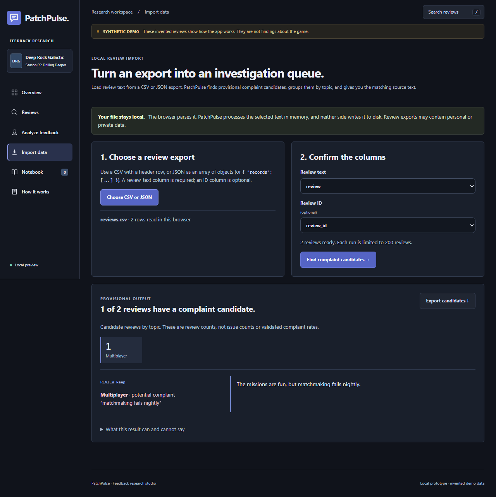
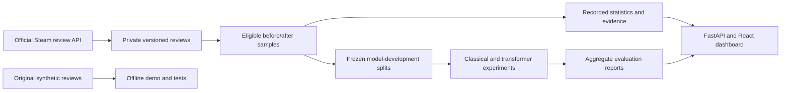

# PatchPulse

[](https://github.com/bryanbans/patchpulse/actions/workflows/ci.yml)

**Understand player feedback before and after a game update.**

After a game update, an overall rating only tells part of the story. A developer also needs to know what players enjoy, what frustrates them, and which comments support that picture.

PatchPulse brings recommendation trends, review topics, and supporting passages into one place. It helps you investigate feedback before and after an update, then look more closely at praise and complaints within individual reviews.


## What questions does PatchPulse help answer?

| Question | What you can do today |
|---|---|
| **Did recommendations change after an update?** | Compare recommendation rates and review counts in equal windows before and after the release date. |
| **What are players talking about?** | Explore keyword mentions of performance, crashes, multiplayer, gameplay, and other topics. |
| **Can one review praise gameplay and criticize multiplayer?** | Open Analyze feedback to see suggested praise or complaints for individual topics, together with the passages behind each suggestion. |
| **What did players actually say?** | Filter reviews and inspect the exact passages behind topic matches. |
| **How much evidence supports an observation?** | See sample sizes, collection coverage, exclusions, and source-version details. |
| **What can I share with a teammate?** | Export the recorded-statistics brief, or collect source-linked passages and your own interpretations in a session notebook. Review private content before sharing. |

These comparisons describe the collected reviews. They do not prove that an update caused a change.

## The challenge: a thumbs-up does not tell the whole story

Consider this invented review:

> “I'd recommend the game, but our co-op sessions keep disconnecting.”

The overall recommendation is positive. The multiplayer feedback is negative. Treating the entire review as either positive or negative loses information a developer could use.

PatchPulse is being built to preserve that distinction: **what players recommend, what they discuss, and what they praise or criticize are different questions.**

Today, the application shows recorded recommendations, keyword-based topic mentions, and a **working prototype that separates explicit praise from complaints by topic**. Try the [feedback workspace](http://127.0.0.1:8000/feedback) after local setup. The default method uses transparent clause and negation rules; a second classifier trains on original synthetic examples. Outputs are marked as suggestions that need checking. Reliable real-world detection still requires human-reviewed evaluation. [How the prototype works](docs/aspect_sentiment.md).

## Use your own review export

PatchPulse is usable with a local review export, not only the bundled demo. Start the app, open **Import data**, select a CSV or JSON file, choose the column containing review text, then run the complaint-candidate queue.

- CSV needs a header row. JSON may be an array of review objects or `{ "records": [...] }`.
- The text field is required; an ID field is optional and is carried into the exported candidate queue.
- Each run accepts up to 200 reviews and up to 1.5 MB in the browser. Split larger exports into batches.
- The browser parses the file and sends the selected text to the loopback process for inference only. PatchPulse does not write imported data to disk, persist it in browser storage, or upload it to a remote service.

The output lists exact passages that matched transparent complaint rules and a topic-level candidate count. It is a review queue, not an issue count, a defect confirmation, or a validated complaint rate. Read the full review before making a product decision; no match does not prove that a review contains no complaint.



## Current project status

**Working local prototype with a reproducible NLP study.**

- The public demo uses 48 clearly labeled, original synthetic reviews. It runs without Steam access, a GPU, or paid AI services after dependency installation.
- A separate private study examines Deep Rock Galactic's Season 05 update. Public reports contain aggregate results; source review text, identifiers, and trained models stay out of this repository.
- Recommendation prediction is a separate model experiment. It never replaces a review's known recommendation in the before-and-after statistics.
- Complaint/praise rules now handle repair negation and preserve uncertainty for questions, wishes, and ambiguous topics. A [reproducible development suite](docs/aspect_sentiment.md#version-3-development-checks-and-measured-changes) records improvements and remaining failures; these authored checks do not establish real-world accuracy.
- Human-evaluated topic sentiment, final temporal evaluation, and evaluation on an unseen game remain unfinished.

## The NLP study

The technical challenge follows from the product question: understanding a review means more than assigning one positive or negative label. PatchPulse uses natural language processing (NLP)—methods for analyzing written language—to explore mixed feedback and compare ways of predicting overall recommendations.

The study asks whether a more complex model actually improves detection, especially when negative reviews are much less common than positive ones. Its methods and results are documented so the choices can be inspected and reproduced.

The first experiment exposed a common evaluation trap: **97% accuracy hid a model that detected none of the negative reviews.** Features based on short character sequences improved the result. A subsequent fine-tuning experiment with DistilBERT, a pretrained transformer language model, did not beat that classical model at its tested decision threshold.

| Model | Validation macro F1¹ | Negative reviews detected | Recommended reviews incorrectly flagged |
|---|---:|---:|---:|
| Initial word-based classifier | 0.493 | 0 of 12 | 0 |
| Selected character-based classifier | **0.757** | **5 of 12** | **2** |
| DistilBERT, both tested loss variants | 0.493 | 0 of 12 | 0 |

¹ Macro F1 gives each recommendation class equal weight. These are development results on 406 reviews, including only 12 negative examples—not final performance estimates. Classical thresholds were tuned using training-only predictions; the neural threshold stayed at 0.5. DistilBERT was fully fine-tuned across three seeds, two loss variants, and two epochs per run. Every neural checkpoint made the same class decisions at that threshold.

The character classifier remains the active private detector. The study records the neural failure, uncertainty, truncation, and resource use rather than assuming a transformer must be better. Final tests remain unopened.

[Read the NLP case study](docs/nlp_study.md) · [Classical comparison](docs/negative_detection.md) · [Model cards](docs/model_card.md) · [Results and data limitations](docs/evaluation.md)

## Try the demo

Install Python 3.12, [uv](https://docs.astral.sh/uv/), and Node.js 24, then run:

```shell
uv sync --frozen --python 3.12
uv run python -m patchpulse build-demo
npm ci --prefix web
npm run build --prefix web
uv run python -m patchpulse serve
```

Open http://127.0.0.1:8000. Compare the two review windows, explore the evidence, try the text classifier in **Analyze feedback**, and inspect the results in **How it works**. Analysis text/results remain in browser memory while this workspace is open; the local server does not retain input. Refreshing or leaving clears that working state. Open `/feedback` to try **Praise + complaint**, **No crashes**, and **Mixed feedback**, or send a review from Reviews using **Analyze this review**.

A practical workflow: choose a topic in **Overview**, select a review in **Reviews**, and use **Analyze this review** to inspect suggested praise or complaints. Save useful reviews/passages to **Notebook**, add your interpretation, and export your notes. Notebook keeps source context and marks machine labels as suggestions; it is not an annotation export. Notes are not saved automatically and are cleared on refresh or when leaving the app.

The synthetic demo demonstrates the workflow; its predictions and review statistics are not real game findings. The How it works page separately labels aggregate results from the private real-data study.

## Data and design

The private study retained **3,575 eligible reviews** across two 14-day windows around the update. Recommendation rates were 837/853 before and 2,643/2,722 after: a **1.03 percentage-point decrease within the collected sample**. Reviews edited beyond their window cutoff and empty texts were excluded. Collection also found a one-review discrepancy between the source's advertised count and returned records; that limitation remains visible.

PatchPulse preserves immutable review versions, records collection gaps, and removes exact/near duplicates before splitting modeling data. Training, validation, and final-test membership are frozen so model selection cannot silently change the comparison.



Built with Python, FastAPI, SQLite, scikit-learn, React, and TypeScript. Optional neural experiments use PyTorch and Hugging Face Transformers. Dependencies and model revisions are pinned.

## Explore the project

- [Setup, development, private-study reproduction, and checks](docs/reproduction.md)
- [NLP case study and failure analysis](docs/nlp_study.md)
- [Data source and reuse audit](docs/data_sources.md)
- [Human annotation guide](docs/annotation_guide.md)
- [Architecture decisions](docs/decisions.md)
- [Feedback studio design system](docs/design_system.md)
- [Verification record](docs/verification.md)
- [Milestones and remaining release work](docs/milestones.md)

The next steps are human-reviewed topic sentiment, a bounded follow-up to the neural experiment, and untouched final evaluations. Source-use questions must be resolved before broader collection or a public real-text demo. Docker configuration is included, but its build has not been verified.

Original code is MIT licensed. Third-party data, models, assets, and trademarks are excluded from that grant. See [third-party notices](THIRD_PARTY_NOTICES.md) and [security/privacy](SECURITY.md). PatchPulse is an independent project and is not affiliated with Valve or the game developers.

### Investigate a possible complaint

Choose **Find potential complaints** to browse rule-suggested passages after the update, including complaints inside recommended reviews. Narrow by topic, window or text; **Why this review matched** shows the exact passage next to the full source review. Analyze a review for the rule explanation, then return to the same review and filters. Save useful evidence to Notebook and record the next investigation before exporting.

These filters are experimental retrieval aids, not verified complaint labels or complaint-rate measurements. Mixed passages can match both praise and complaint filters. A review with no match may still contain a complaint. Notebook interpretations and next steps are your own; they remain session-only until exported.
