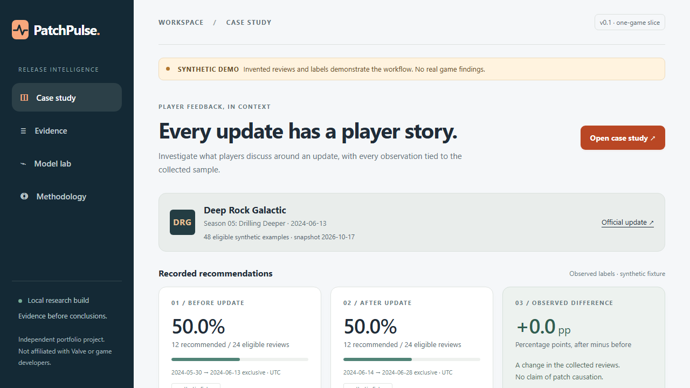
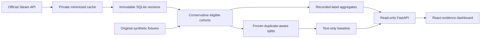

# PatchPulse

[](https://github.com/bryanbans/patchpulse/actions/workflows/ci.yml)

**Investigate player feedback around a game update—with the evidence and the limitations in view.**

PatchPulse helps a developer inspect recorded recommendations, explore feedback mentions, and trace observations to immutable review versions. A recommending review can still criticize multiplayer. Those are separate facts.



**Status: working one-game local vertical slice, not a finished v1 release.** This is an independent personal portfolio project. The shareable demo uses clearly marked synthetic text. Private local research uses Deep Rock Galactic's Season 05 update; source reviews, author groups, and fitted models are excluded from Git.

[GitHub repository](https://github.com/bryanbans/patchpulse) · [Milestones](docs/milestones.md) · [Model card](docs/model_card.md)

## Try it locally

Install Python 3.12, [uv](https://docs.astral.sh/uv/), and Node.js 24. From this repository:

```shell
uv sync --frozen --python 3.12
uv run python -m patchpulse build-demo
npm ci --prefix web
npm run build --prefix web
uv run python -m patchpulse serve
```

Open http://127.0.0.1:8000. The demo runs without Steam access, paid inference, GPU, or pretrained weights. Initial dependency installation needs internet. Its 48 original synthetic examples demonstrate behavior; their metrics are not evidence of real-world model quality. Input in the model lab stays local and is not stored.

For frontend development: run the API as above, then `npm run dev --prefix web`. Vite proxies API calls to port 8000. Restart the API after rebuilding data or models; curated snapshots are cached in-process.

## What the real-data spike found

An October 17, 2026 retrospective collection returned **3,883 distinct reviews** in the two date windows. Conservative eligibility retained **3,575**: 853 before and 2,722 after. We excluded 291 reviews edited beyond their period cutoff and 17 empty texts. Pagination exhausted both windows; the after count was **one below** Steam's advertised 2,953 matching reviews. This discrepancy remains visible, rather than being described as proven complete population coverage.

Within those eligible collected records, recommendations were 837/853 before and 2,643/2,722 after—a **−1.03 percentage-point** difference. This describes the sample and does not establish an update effect. [Machine-readable aggregate report](reports/milestone1-real-aggregates.json).

The first text-only TF-IDF/logistic regression model achieved **0.4925 validation macro F1**, equal to the majority baseline. Its 97.0% validation accuracy hides **zero negative-class recall**: it predicted all 406 validation records as recommended. This is a useful failure to investigate, not a release-quality classifier. The final temporal test remains unopened; the unseen-game test and transformer comparison have not run. [Evaluation and limitations](docs/evaluation.md).

## Negative-detection development update

Six predeclared CPU candidates now share the original frozen split. Training-only grouped out-of-fold scores select thresholds; chronological validation selects the candidate. The selected **balanced character TF-IDF/logistic regression** improves validation macro F1 from **0.4925 to 0.7575**. It detects **5 of 12 negative reviews**, with **2 false alarms** (negative precision 71.4%, recall 41.7%). A more sensitive word model detects 8 of 12, with 21 false alarms.

These are development results from only 12 negative validation examples. The selected model's exploratory 95% bootstrap macro F1 interval is **0.609–0.878** and does not account for model-selection optimism. Final tests remain locked. The public demo still uses synthetic model artifacts; the methodology view separately displays aggregate real-data results. [Comparison and protocol](docs/negative_detection.md) · [Aggregate report](reports/negative-detection-real.json).

The model lab supports local detector comparisons and displays the actual negative-score threshold. The browser annotation workspace at `/annotate` hides source recommendations and predictions, exports only explicitly human-reviewed records, and converts evidence offsets to Python Unicode indices. Real exports stay private. [Annotation guide](docs/annotation_guide.md).

## How it works



- **Observed recommendations:** direct arithmetic on recorded labels, with counts and UTC windows.
- **Text prediction:** separate CPU baseline, bounded input, uncalibrated scores, unknown-vocabulary abstention.
- **Aspect mentions:** transparent keyword matches with exact offsets. They are not complaints or evaluated polarity predictions.
- **Brief:** deterministic sample statistics, coverage, caveats, and supporting version IDs.

Python/FastAPI, SQLite, scikit-learn, React/TypeScript/Vite. Exact dependencies are locked. No paid AI APIs. [Architecture and decisions](docs/decisions.md).

## Reproduce the private study

Review the [source-use audit](docs/data_sources.md) before collecting or using real data. The code does not establish a license for data reuse. These commands keep raw source text, pseudonymous groups, and model files in ignored `private/`:

```shell
uv run python -m patchpulse collect --cap-per-period 3500
uv run python -m patchpulse build-demo --mode real
uv run python -m patchpulse serve --mode real --port 8001
```

Real mode is for local private inspection. Do not deploy it publicly. Current API data can change; a recollection is a new snapshot, not an exact recreation of old reviews. Resume an interrupted run with `collect --cap-per-period 3500 --resume-run RUN_ID` from its private manifest. Resume checks page hashes and reuses saved records. Every period has an independent cap, and capped windows remain explicitly incomplete.

Available CLI commands are `compare-baselines`, `collect`, `prepare`, `build-demo`, `train-baseline`, `annotate-export`, `annotate-import`, and `serve`. `prepare` builds cohorts without fitting. `build-demo` prepares and trains. Annotation commands use the selected `--mode`; import additionally requires `--file`. Full v1 evaluate/transformer/grouping commands remain future work.

## Verification

```shell
uv run ruff check src tests scripts
uv run ruff format --check src tests scripts
uv run pytest -q
npm run build --prefix web
npx --prefix web playwright install chromium
# Keep the synthetic API running on port 8000 in another terminal:
npm test --prefix web
uv run python -m pip_audit --local
npm audit --prefix web --audit-level=high
uv run python scripts/check_public_files.py
```

Tests exercise immutable versions, date boundaries, edit exclusions, duplicate leakage, API filters, bounded inference, retries, terminal-page parsing, injection escaping, export, desktop/mobile behavior, and keyboard focus. CI is offline with respect to Steam; dependency setup needs network. Local GitHub Actions execution is not claimed. Docker configuration is supplied, but its build has not been tested because the local Docker daemon was stopped.

Local exploratory benchmark: 100 warm localhost case-study requests had p95 1.37 ms; CPU model forward calls had p95 0.294 ms on a Ryzen 7 7800X3D. The latter used three repeated original sentences, excluded HTTP, and is not a representative production workload. These are neither browser-load nor deployed latency claims. [Protocol and results](reports/local-benchmark.json).

## Next milestones

Complete human review of the training annotation pilot; expand the approved development dataset; complete human aspect annotation; compare a bounded transformer; then run locked final tests. Resolve source-content permissions before any real-text public demo. [Milestone checklist](docs/milestones.md), [annotation guide](docs/annotation_guide.md), [publication review](docs/publication.md).

Original code is MIT licensed. Third-party data, models, assets, and trademarks are excluded from that grant. See [third-party notices](THIRD_PARTY_NOTICES.md) and [security/privacy](SECURITY.md).
