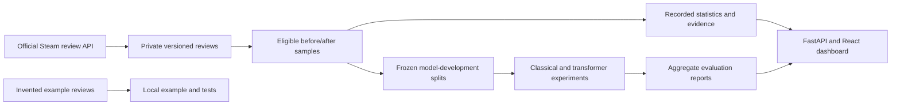

# PatchPulse

[](https://github.com/bryanbans/patchpulse/actions/workflows/ci.yml)

**Find potential complaints in player reviews and inspect the words behind them.**

After a game update, an overall rating only tells part of the story. A developer also needs to know what players enjoy, what frustrates them, and which comments support that picture.

PatchPulse is a local NLP application for exploring game feedback. Import a CSV or JSON review export to find potential complaints by topic, inspect the matching passages alongside the full reviews, and export a review queue. A separate included example explores recommendations and topics before and after an update.

The complaint suggestions use hand-written language rules and require human review. Their accuracy on real player reviews has not yet been established.

## What questions does PatchPulse help answer?

| Question | What you can do today |
|---|---|
| **Which reviews may contain complaints?** | Import your own reviews to see rule-suggested complaint passages and export a candidate queue. |
| **Can one review praise gameplay and criticize multiplayer?** | Analyze individual feedback for suggested praise and complaints by topic, with the passages behind each suggestion. |
| **Did recommendations change after an update?** | In the bundled example, compare recommendation rates and review counts in equal windows around the release. |
| **What are players talking about?** | In the bundled example, explore keyword mentions and inspect the full reviews behind topic matches. |
| **What can I share with a teammate?** | Export your imported candidate queue, or use the bundled example to make a statistics brief and session notebook. Review private content before sharing. |

The comparison uses the included example reviews. Imported files do not currently populate the before-and-after views. Such comparisons describe the reviews in the collection; they do not prove that an update caused a change.

## The challenge: a thumbs-up does not tell the whole story

Consider this invented review:

> “I'd recommend the game, but our co-op sessions keep disconnecting.”

The overall recommendation is positive. The multiplayer feedback is negative. Treating the entire review as either positive or negative loses information a developer could use.

PatchPulse is being built to preserve that distinction: **what players recommend, what they discuss, and what they praise or criticize are different questions.**

Today, the application shows recommendations and keyword-based topic mentions in its example collection, and **suggests praise and complaints by topic** in individual reviews. Try the [feedback workspace](http://127.0.0.1:8000/feedback) after local setup. The default method uses transparent clause and negation rules; a second classifier trains on generated examples. Outputs are suggestions that need checking. Reliable real-world detection still requires human-reviewed evaluation. [How the analysis works](docs/aspect_sentiment.md).

## Use your own review export

Start the app, open **Import data**, select a CSV or JSON file, choose the column containing review text, then run the complaint-candidate queue.

For a quick test, save the following invented reviews as `reviews.csv` and import that file:

```csv
review_id,review
101,"The missions are fun, but matchmaking fails every night."
102,"The soundtrack is excellent."
```

Select `review` as the text column and `review_id` as the optional ID. PatchPulse will show potential complaints, their matching passages, and the complete review; use **Export candidates** to save the queue as a text file.

- CSV needs a header row. JSON may be an array of review objects or `{ "records": [...] }`.
- The text field is required; an ID field is optional, limited to 200 characters, and carried into the exported candidate queue.
- Each run accepts up to 200 nonempty reviews, each up to 8,000 characters; the selected file must be at most 1.5 MB. Split larger exports into batches.
- The browser parses the file and sends the selected text to the local server for analysis. PatchPulse does not automatically save the imported data or send it to a remote service. An exported queue is downloaded to your computer and contains review text.

The output lists exact passages that matched transparent complaint rules and a topic-level candidate count. It is a review queue, not an issue count, a defect confirmation, or a validated complaint rate. Read the full review before making a product decision; no match does not prove that a review contains no complaint.

Import analyzes reviews in the **Import data** workspace. Overview and Reviews continue to show the included example collection; imported files do not yet produce before-and-after comparisons.

## Current project status

**A working local feedback analysis tool with ongoing evaluation.**

- The included example collection contains 48 invented reviews. The app runs without Steam access, a GPU, or paid AI services after dependency installation, and accepts your own review exports.
- A separate private study examines Deep Rock Galactic's Season 05 update. Public reports contain aggregate results; source review text, identifiers, and trained models stay out of this repository.
- Recommendation prediction is a separate model experiment. It never replaces a review's known recommendation in the before-and-after statistics.
- Complaint/praise rules now handle repair negation and preserve uncertainty for questions, wishes, and ambiguous topics. A [reproducible development suite](docs/aspect_sentiment.md#version-4-development-checks-and-measured-changes) records improvements and remaining failures; these authored checks do not establish real-world accuracy.
- Human-reviewed evaluation of complaint detection, final temporal evaluation, and evaluation on an unseen game remain unfinished. Authored example checks are development tests, not an independent benchmark.

## The NLP study

The technical challenge follows from the product question: understanding a review means more than assigning one positive or negative label. PatchPulse uses natural language processing (NLP)—methods for analyzing written language—to explore mixed feedback and compare ways of predicting overall recommendations.

In a separate private-data experiment, the study asks whether a more complex model better predicts a review's recorded recommendation, especially when not-recommended reviews are much less common. This experiment measures whole-review recommendation prediction; it does not validate the topic-level complaint detector. The app and documented protocols can be run locally. Reproducing the private study requires the separately retained source data and models.

The first experiment exposed a common evaluation trap: **97% accuracy hid a model that detected none of the negative reviews.** Features based on short character sequences improved the result. A subsequent fine-tuning experiment with DistilBERT, a pretrained transformer language model, did not beat that classical model at its tested decision threshold.

| Recommendation model | Validation macro F1¹ | Not-recommended reviews detected | Recommended reviews incorrectly flagged |
|---|---:|---:|---:|
| Initial word-based classifier | 0.493 | 0 of 12 | 0 |
| Selected character-based classifier | **0.757** | **5 of 12** | **2** |
| DistilBERT, both tested loss variants | 0.493 | 0 of 12 | 0 |

¹ Macro F1 gives each recommendation class equal weight. These are development results on 406 reviews, including only 12 negative examples—not final performance estimates. Classical thresholds were tuned using training-only predictions; the neural threshold stayed at 0.5. DistilBERT was fully fine-tuned across three seeds, two loss variants, and two epochs per run. Every neural checkpoint made the same class decisions at that threshold.

The character classifier remains the active private detector. The study records the neural failure, uncertainty, truncation, and resource use rather than assuming a transformer must be better. Final tests remain unopened.

[Read the NLP case study](docs/nlp_study.md) · [Classical comparison](docs/negative_detection.md) · [Model cards](docs/model_card.md) · [Results and data limitations](docs/evaluation.md)

## Install and run

Install Python 3.12, [uv](https://docs.astral.sh/uv/), and Node.js 24, then run:

```shell
git clone https://github.com/bryanbans/patchpulse.git
cd patchpulse
uv sync --frozen --python 3.12
uv run python -m patchpulse build-demo
npm ci --prefix web
npm run build --prefix web
uv run python -m patchpulse serve
```

Open http://127.0.0.1:8000. Compare the two review windows, explore the evidence, try the text classifier in **Analyze feedback**, and inspect the results in **How it works**. Analysis text/results remain in browser memory while this workspace is open; the local server does not retain input. Refreshing or leaving clears that working state. Open `/feedback` to try **Praise + complaint**, **No crashes**, and **Mixed feedback**, or send a review from Reviews using **Analyze this review**.

To explore the included example collection, choose **Find potential complaints**, narrow by topic or text, and inspect the matching passage beside the full review. Use **Analyze this review** for a rule explanation, then return to your filters. Save useful reviews or passages to **Notebook**, add your interpretation, and export your notes. Labels remain suggestions; notes are session-only until exported and are cleared on refresh or when leaving the app.

The included example reviews are invented, so their statistics are not findings about a real game. The How it works page separately labels aggregate results from the private real-data study.

## Data and design

The private study retained **3,575 eligible reviews** across two 14-day windows around the update. Recommendation rates were 837/853 before and 2,643/2,722 after: a **1.03 percentage-point decrease within the collected sample**. Reviews edited beyond their window cutoff and empty texts were excluded. Collection also found a one-review discrepancy between the source's advertised count and returned records; that limitation remains visible.

PatchPulse preserves immutable review versions, records collection gaps, and removes exact/near duplicates before splitting modeling data. Training, validation, and final-test membership are frozen so model selection cannot silently change the comparison.



Built with Python, FastAPI, SQLite, scikit-learn, React, and TypeScript. Optional neural experiments use PyTorch and Hugging Face Transformers. Dependencies and model revisions are pinned.

## Explore the project

- [Setup, development, private-study reproduction, and checks](docs/reproduction.md)
- [NLP case study and failure analysis](docs/nlp_study.md)
- [Data source and reuse audit](docs/data_sources.md)
- [Human annotation guide](docs/annotation_guide.md)
- [Architecture decisions](docs/decisions.md)
- [Feedback studio design system](docs/design_system.md)
- [Verification record](docs/verification.md)
- [Milestones and remaining release work](docs/milestones.md)

The next steps are human-reviewed topic sentiment, a bounded follow-up to the neural experiment, and untouched final evaluations. Source-use questions must be resolved before broader collection or public display of real review text. Docker configuration is included, but its build has not been verified.

Original code is MIT licensed. Third-party data, models, assets, and trademarks are excluded from that grant. See [third-party notices](THIRD_PARTY_NOTICES.md) and [security/privacy](SECURITY.md). PatchPulse is an independent project and is not affiliated with Valve or the game developers.
