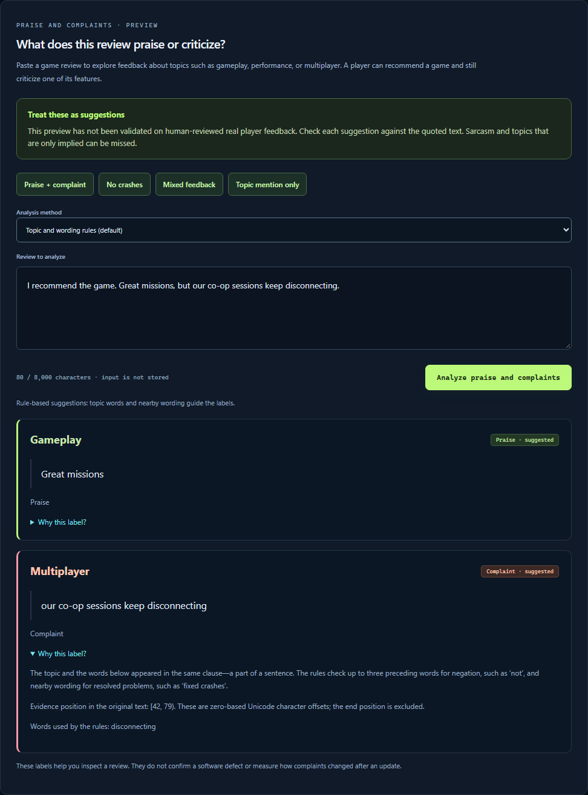

# Complaint versus praise: working aspect prototype

PatchPulse now has a local feedback workspace at `/feedback` (also the first panel in Analyze feedback). It analyzes individual review text without using the overall recommendation as an aspect label.

## A concrete synthetic example

Original invented review:

> I recommend the game. Great missions, but our co-op sessions keep disconnecting.

The rule baseline returns Gameplay / positive with the exact passage `Great missions`, and Multiplayer / negative with `our co-op sessions keep disconnecting`. The overall recommendation sentence does not make either aspect positive. Both outputs are explicitly provisional. This is synthetic authored material, not a real player quote or a human-reviewed training label.



## What works

- Exact raw-text Unicode offsets survive sentence/clause segmentation, contrast words and supported coordinating constructions.
- Transparent aspect patterns and positive/negative lexical cues identify explicit praise and complaints.
- A bounded three-token negation window handles examples such as `no crashes` and `performance is not great`. Resolution phrases such as `fixed crashes` are handled separately from active failures.
- Positive and negative statements about the same aspect combine into mixed feedback. Clauses with multiple aspects and conflicting cues stay uncertain rather than assigning all sentiment to every aspect.
- Questions and mentions without recognized evaluative cues can remain uncertain. Uncertain, neutral and absent are separate states. Exact evidence is traceable, but exact offsets alone do not establish semantic correctness.
- The Reviews view can send a selected review to the feedback workspace. Existing before/after topic counts remain mention counts, not complaint counts.
- The same API can use a supervised passage-polarity classifier. Its aspect assignment still uses rules, so it is not an end-to-end learned aspect model.

Rules can miss implicit topics, Other issue, sarcasm, idioms and longer negation dependencies. They are a baseline, not a production sentiment engine. Automatic complaint-change statistics remain withheld in real mode pending human evaluation.

## Synthetic supervised workflow

At the user's request, 48 original, human-style synthetic review passages and labels were authored with AI assistance. Twelve examples cover each of positive, negative, mixed and neutral, spanning the aspect taxonomy. Every fixture record has `human_reviewed: false`; no independent human review is claimed.

`build-demo` trains the synthetic passage model automatically. It can also be reproduced with:

```shell
uv run python -m patchpulse train-aspects --mode synthetic
uv run python scripts/export_aspect_workflow.py
```

The fixed protocol is word/character TF-IDF plus balanced logistic regression, C=1. Passage fitting never uses the overall recommendation. A fixed seed-42 group split keeps all evidence from one review/author together. Exact normalized cross-group duplicate passages are quarantined; semantic duplicate removal is not guaranteed. Conflicting labels on identical passages require an aspect-conditioned representation or span review, rather than silent fitting.

The current authored fixture yields 36 training and 12 validation passages. Macro F1 is approximately **0.211** on this tiny synthetic split. This low result is recorded honestly and is **not a real-player benchmark**. The default interactive method remains transparent rules. The supervised option demonstrates the fitting, splitting, inference, artifact-integrity and evaluation path; it is not presented as a stronger detector. Scores are uncalibrated. Clause inference can differ from short annotated training spans.

[Fixture provenance and generated workflow report](../reports/aspect-synthetic-workflow.json) · [Authored examples](../data/fixtures/aspect-polarity.json) · [Training configuration](../configs/aspects.json).

## Real-data training gate

`train-aspects --mode real` requires actual reviewed annotation imports, training-partition membership, an explicitly frozen guide (`taxonomy_frozen` currently false), and minimum independent training support in every polarity class. Synthetic fixture labels do not satisfy this gate. The current real annotation pilot and recommendation final tests are unchanged.

Each annotation snapshot has a content fingerprint; its deterministic group split and fitted model are saved in a new private run directory. Report support per class, unsupported aspects, author overlap policy, duplicates and label limitations. Do not search random seeds to obtain a favorable split. A training-only pilot result is not a final temporal or unseen-game score.

The remaining evaluation must separately measure aspect detection, polarity on known passages, end-to-end aspect/polarity decisions, evidence relevance, and errors on mixed and absent aspects. Human review and a stable taxonomy are prerequisites for real quality claims. A synthetic workflow is useful for engineering and demonstration, not a replacement for that evidence.

## API and labeling workflow

- `GET /api/feedback-status`: available methods and provenance for the current data mode.
- `POST /api/analyze-feedback`: `{text, method}` where method is `rules` or `supervised`; at most 8,000 characters. Unknown fields, including recommendation labels, are rejected. The shared local inference rate limit also applies. Input is not stored.
- Fitted model files remain private and SHA-256 checked. Real mode cannot silently load the synthetic model.
- Annotation exports can now be reloaded using **Resume from a reviewed export**. Matching source versions, exact Unicode spans, categories and explicit review flags are validated in the browser. Processing stays local; importing does not upload the labels to the server. Export before leaving; there is no automatic browser persistence.

The original recommendation study, model selection and final-test manifest remain intact. No raw real review text or fitted weights are added to GitHub.
